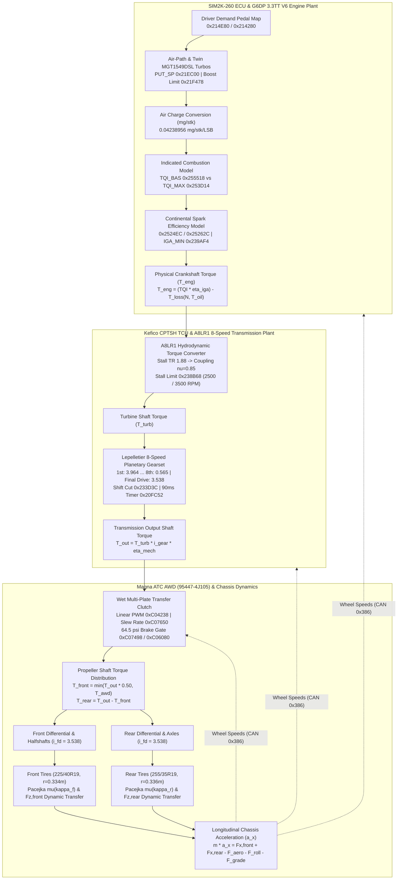
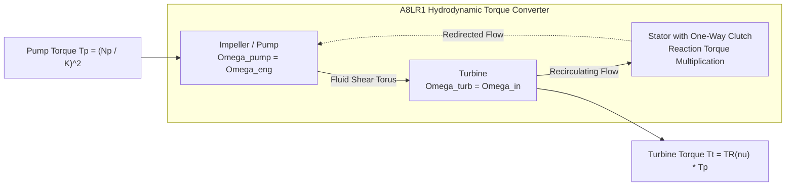
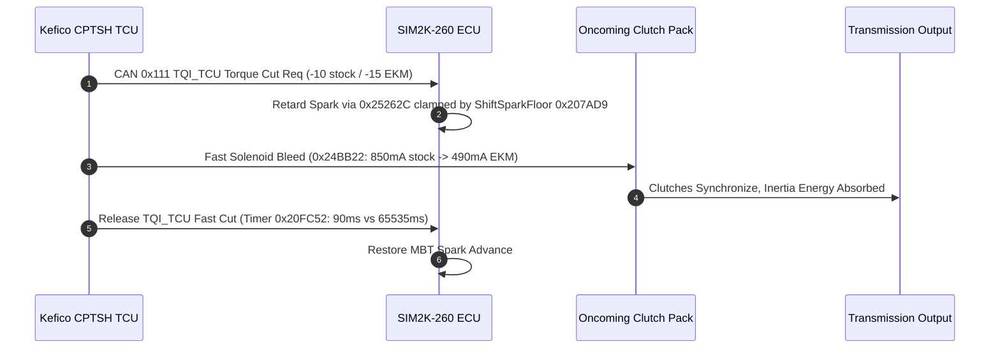
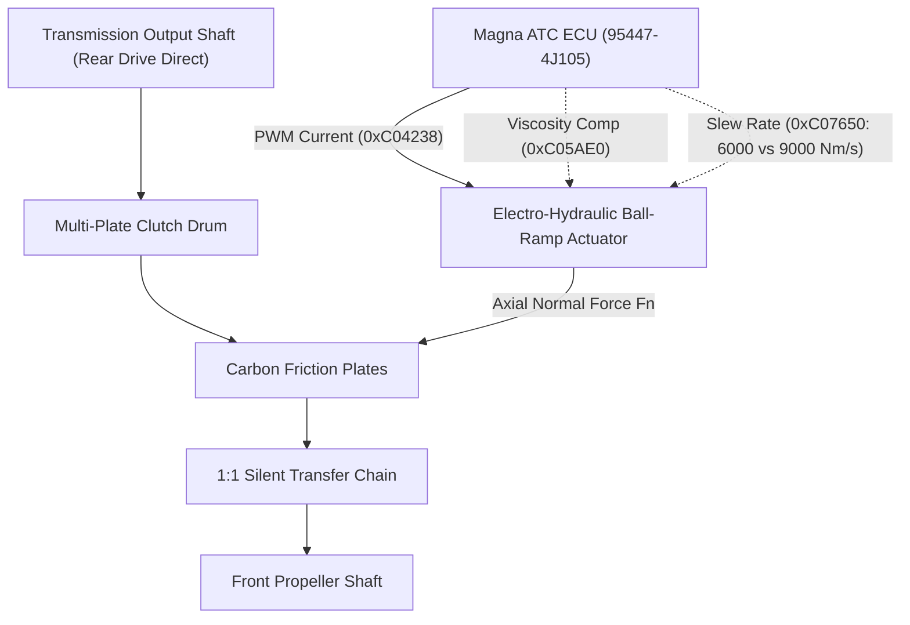
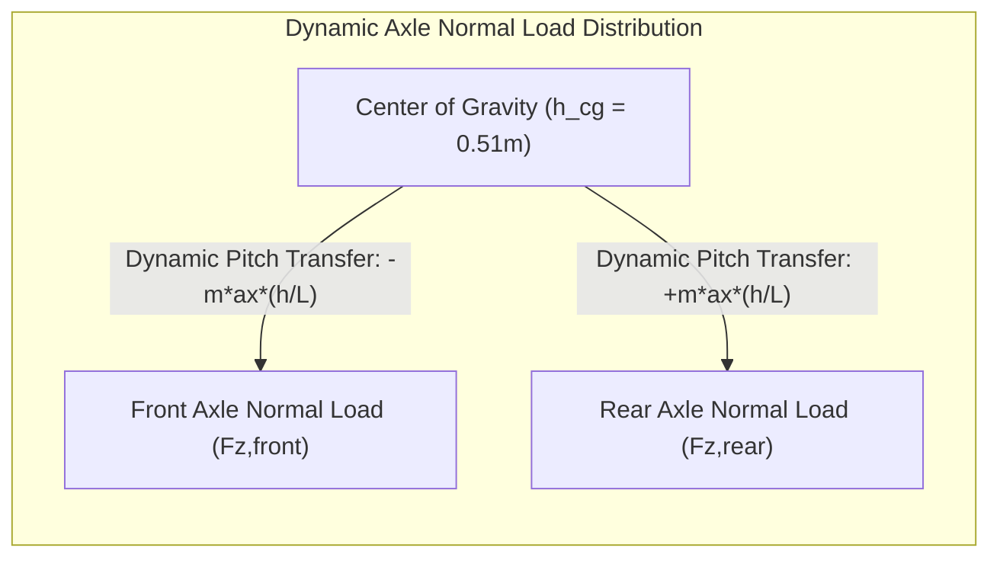
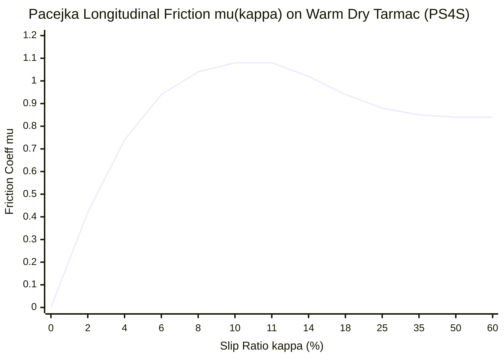

# Physical Powertrain Model Specification: 3.3L Twin-Turbo V6 (Lambda II G6DP) + 8-Speed Automatic (A8LR1) + Magna ATC AWD

> **Target Platform**: Kia Stinger GT / Genesis G70 3.3T AWD  
> **Firmware Modules**: Continental SIM2K-260 ECU (`640C7000`), Kefico CPTSH 8AT TCU (`95441-4J571`), Magna ATC AWD ECU (`95447-4J105`)  
> **Authoring**: Simulation Master Advanced Powertrain Modeling Team  
> **Classification**: Closed-Loop Physical & Calibration-Correlated Plant Specification

---

## Executive Summary & System Architecture

This document establishes the first-principles physical, thermodynamic, kinematic, and hydrodynamic equations governing the longitudinal powertrain of the Kia Stinger GT and Genesis G70 3.3L Twin-Turbo V6 AWD platform. Every physical equation is explicitly correlated to binary addresses, calibration maps, LSB quantizations, and firmware state machines reverse-engineered from the **SIM2K-260 ECU**, **Kefico CPTSH TCU**, and **Magna ATC AWD ECU**.

---

## 1. Engine Sub-Model: Hyundai/Genesis 3.3L Twin-Turbo V6 (`G6DP`) — SIM2K-260

### 1.1 Complete Geometric & Mechanical Architecture

The Lambda II `G6DP` is a 60-degree, all-aluminum, twin-turbocharged, 24-valve, dual-overhead-camshaft (DOHC) direct-injected (GDI) V6. The cylinder heads feature integrated exhaust manifolds (cylinder pairs 1-2-3 and 4-5-6 merge directly inside the aluminum casting into twin mono-scroll turbine flanges), minimizing exhaust gas distance to the turbine wheels and reducing turbo lag.

| Parameter | Symbol | Nominal Value | Units | Engineering Notes |
|---|---|---|---|---|
| Total Displacement | $V_d$ | $3,342.0$ | $\text{cm}^3$ | Swept cylinder volume $\times 6$ |
| Cylinder Bore | $B$ | $92.0$ | $\text{mm}$ | Cast iron cylinder liners in aluminum block |
| Piston Stroke | $S$ | $83.8$ | $\text{mm}$ | Forged steel micro-alloyed crankshaft |
| Bore-to-Stroke Ratio | $B/S$ | $1.098$ | — | Over-square architecture favoring high-RPM breathing |
| Single Cylinder Swept Volume | $V_{\text{cyl}}$ | $557.0$ | $\text{cm}^3$ | $\frac{\pi}{4} B^2 S$ |
| Clearance Volume | $V_c$ | $61.89$ | $\text{cm}^3$ | Per cylinder at Top Dead Center (TDC) |
| Static Compression Ratio | $r_c$ | $10.0:1$ | — | $r_c = \frac{V_{\text{cyl}} + V_c}{V_c}$ |
| Connecting Rod Length | $L_{\text{rod}}$ | $152.5$ | $\text{mm}$ | Center-to-center forged steel rod |
| Rod-to-Stroke Ratio | $\lambda_{\text{rod}}$ | $1.820$ | — | $L_{\text{rod}} / S$, reduces piston side-skirt thrust load |
| Bank Angle | $\alpha_{\text{bank}}$ | $60.0$ | $\text{deg}$ | Natural even-firing 120-degree firing interval |
| Firing Order | — | `1-2-3-4-5-6` | — | Cylinder 1 front right, Cylinder 4 front left |
| Crankshaft Rotational Inertia | $J_{\text{eng}}$ | $0.240$ | $\text{kg}\cdot\text{m}^2$ | Crankshaft, dual-mass flywheel, and TC impeller |
| Idle Engine Speed | $N_{\text{idle}}$ | $850.0$ | $\text{RPM}$ | Target idle in Sport / Warm Closed-Loop |
| Maximum Governed Speed | $N_{\text{redline}}$ | $6,600.0$ | $\text{RPM}$ | Hard fuel cut at $6,650\text{ RPM}$ (`0x200B10`) |

### 1.2 Dual-CVVT Valvetrain & Cam-Phaser Kinematics

Both intake and exhaust camshafts are equipped with high-speed hydraulic Continuously Variable Valve Timing (`Dual-CVVT`) phasers capable of continuous intermediate locking:
- **Intake Cam Phaser**: $50^\circ\text{ CA}$ continuous advance authority.
- **Exhaust Cam Phaser**: $40^\circ\text{ CA}$ continuous retard authority.

In the SIM2K-260 ROM, the instantaneous volumetric efficiency and combustion torque envelopes are scheduled across **8 discrete cam overlap states** (`0x253D14` through `0x254F94`). The forward model resolves the instantaneous cam envelope:
$$\text{TQI\_MAX}(N, m_{\text{air}}) = \sum_{k=1}^{8} w_k(\theta_{\text{int}}, \theta_{\text{exh}}) \cdot \text{TQI\_CAM}_k(N, m_{\text{air}})$$

### 1.3 Turbocharger Compressor & Turbine Thermodynamics

The G6DP is equipped with twin mirrored **Garrett MGT1549DSL** wastegated mono-scroll turbochargers:
- **Compressor Wheel**: Inducer diameter $D_{c,i} = 36.4\text{ mm}$, Exducer diameter $D_{c,e} = 49.0\text{ mm}$, Trim $55.2$.
- **Turbine Wheel**: Inducer diameter $D_{t,i} = 45.0\text{ mm}$, Exducer diameter $D_{t,e} = 40.2\text{ mm}$, Trim $79.8$.
- **Wastegate**: Integrated electronic PWM actuator with linear Hall-effect position feedback.

#### Compressor Thermodynamic Equations
The compressor pressure ratio $\Pi_c$ is governed by upstream-throttle manifold pressure $P_{\text{put}}$ relative to ambient inlet pressure $P_{\text{amb}}$:
$$\Pi_c = \frac{P_{\text{put}}}{P_{\text{amb}} - \Delta P_{\text{intake}}}$$

The compressor discharge temperature $T_{c,\text{out}}$ before charge cooling:
$$T_{c,\text{out}} = T_{\text{amb}} \left[ 1 + \frac{1}{\eta_c} \left( \Pi_c^{\frac{\gamma - 1}{\gamma}} - 1 \right) \right]$$
where $\gamma = 1.40$ (ratio of specific heats for dry air) and $\eta_c \in [0.68, 0.76]$ is the compressor isentropic efficiency.

#### Charge Air Cooler (Intercooler) Pressure Drop & Thermal Efficiency
The dual air-to-air heat exchangers exhibit a thermal efficiency $\epsilon_{\text{ic}} \approx 0.78$ at $100\text{ km/h}$ face velocity and an aerodynamic pressure drop $\Delta P_{\text{ic}}$:
$$\Delta P_{\text{ic}} = \zeta_{\text{ic}} \cdot \frac{1}{2} \rho_c v_{\text{core}}^2 \approx 0.045 \cdot \left(\frac{\dot{m}_{\text{air}}}{100\text{ g/s}}\right)^{1.85}\ [\text{bar}]$$
$$T_{\text{im}} = T_{c,\text{out}} - \epsilon_{\text{ic}} (T_{c,\text{out}} - T_{\text{amb}})$$

### 1.4 Volumetric Efficiency & SIM2K-260 Air Charge Conversion

The cylinder air mass induction per four-stroke intake stroke $m_{\text{air}}$ ($\text{mg/stroke}$) is computed via the ideal gas relation modified by the engine volumetric efficiency $\eta_v(N, P_{\text{im}})$:
$$m_{\text{air}} = \frac{P_{\text{im}} \cdot V_{\text{cyl}}}{R_{\text{specific}} \cdot T_{\text{im}}} \cdot \eta_v(N, P_{\text{im}})$$
where:
- $R_{\text{specific}} = 287.058\ \frac{\text{J}}{\text{kg}\cdot\text{K}}$ is the specific gas constant for air.
- $V_{\text{cyl}} = 557.0\times 10^{-6}\ \text{m}^3$.
- $\eta_v(N, P_{\text{im}})$ is calibrated in the SIM2K-260 internal model:
$$\eta_v(N) = \begin{cases} 
0.90 + 0.10 \cdot \left(\frac{N - 1000}{1000}\right) & 1000 \le N < 2000\text{ RPM} \\
1.00 & 2000 \le N \le 5400\text{ RPM} \\
1.00 - 0.07 \cdot \left(\frac{N - 5400}{1200}\right) & 5400 < N \le 6600\text{ RPM}
\end{cases}$$

#### SIM2K-260 Binary Airload LSB Quantization
Continental SIM2K-260 represents cylinder air charge as a 16-bit unsigned integer scaled by the universal Continental/Siemens air charge quantization constant:
$$\text{Airload (mg/stroke)} = \text{RAW\_VALUE}_{16} \times 0.04238956\ \frac{\text{mg/stk}}{\text{LSB}}$$
At maximum boost setpoint ($2717\text{ hPa}$), typical WOT cylinder air charge reaches:
$$\text{Airload}_{\text{peak}} \approx 1,350.0\ \text{mg/stk} \implies \text{RAW} = \frac{1350.0}{0.04238956} \approx 31,847\ (\text{hex } \mathtt{0x7C67})$$

### 1.5 Manifold Pressure Ceilings & The TCHA Overspeed Limiter

In the factory Continental SIM2K-260 firmware:
- `0x21EC00` (`PUT_SP`): Primary manifold boost setpoint ceiling, hardcoded at **$2,717.0\text{ hPa}$** absolute ($1.704\text{ bar}$ / $24.7\text{ psi}$ boost gauge at sea level).
- `0x21F478` (`Boost Limit A`): Atmospheric pressure and ambient temperature derating envelope ($2,717.0\text{ hPa}$).
- `0x203EC6` (`TCHA Limiter Debounce`): Turbocharger overspeed protection logic. When calculated internal indicated torque exceeds $710.0\text{ Nm}$ above $2,700\text{ RPM}$ for more than $10\text{ cycles}$ ($100\text{ ms}$), the ECU trips a protective throttle cut:
$$\text{Cap}_{\text{TCHA}} = \text{0x203ED4} = 200.0\text{ Nm}$$
Upon recovery, torque ramps up by `0x203ED8` ($17.0\text{ Nm}$ per $10\text{ ms}$ cycle) back to uncapped torque. In properly calibrated binaries (e.g. `v103`), `0x203EC6` is disabled by setting debounce cycles to $65,535$.

### 1.6 Combustion Torque, Friction Losses, and Spark Efficiency

#### Forward Indicated Torque Model
The indicated engine combustion torque $T_{\text{ind}}$ is looked up from the dual $18\times 20$ forward calibration tables:
- `0x255518` (`TQIBasA`): Base indicated combustion torque $T_{\text{ind},\text{bas}}(N, m_{\text{air}})$ under stoichiometric combustion ($\lambda = 1.00$) at MBT spark advance.
- `0x253D14`..`0x254F94`: Maximum indicated torque envelope across cam overlap states $T_{\text{ind},\text{max}}(N, m_{\text{air}})$.

#### Engine Pumping & Mechanical Friction Loss Polynomial (FMEP + PMEP)
Friction and pumping torque losses $T_{\text{loss}}(N, T_{\text{oil}})$ are modeled using a second-order polynomial with an empirical kinematic viscosity temperature scaling factor:
$$T_{\text{loss}}(N, T_{\text{coolant}}) = \left(C_0 + C_1 N + C_2 N^2\right) \cdot \Phi(T_{\text{coolant}})$$
where:
$$C_0 = 34.0\text{ Nm},\quad C_1 = 0.0045\ \frac{\text{Nm}}{\text{RPM}},\quad C_2 = 1.0\times 10^{-6}\ \frac{\text{Nm}}{\text{RPM}^2}$$
$$\Phi(T_{\text{coolant}}) = \begin{cases}
1.0 + 0.0062(85 - T) + 0.000045(85 - T)^2 & T < 85.0^\circ\text{C} \\
1.0 & T = 85.0^\circ\text{C} \\
\max(0.88, 1.0 - 0.0035(T - 85)) & T > 85.0^\circ\text{C}
\end{cases}$$
At standard warm operating temperature ($85^\circ\text{C}$):
- At $850\text{ RPM}$ (idle): $T_{\text{loss}} = 34.0 + 3.825 + 0.72 = 38.55\text{ Nm}$.
- At $3,000\text{ RPM}$: $T_{\text{loss}} = 34.0 + 13.50 + 9.00 = 56.50\text{ Nm}$.
- At $6,500\text{ RPM}$ (redline): $T_{\text{loss}} = 34.0 + 29.25 + 42.25 = 105.50\text{ Nm}$.

#### Ignition Timing & Continental Spark Efficiency Model
The actual delivered crankshaft brake torque $T_{\text{brake}}$ is modulated by ignition timing relative to the optimum Maximum Brake Torque (MBT) spark timing:
$$\theta_{\text{mbt}} = \text{Map}_{\text{0x238874}}(N, m_{\text{air}})$$
$$\theta_{\text{base}} = \text{Map}_{\text{0x238090}}(N, m_{\text{air}})$$

When torque reduction is requested (by TCU during shifts or ESC during wheelspin), the ECU retards ignition timing by $\Delta\theta = \theta_{\text{base}} - \theta_{\text{actual}} \ge 0$.
The Continental torque efficiency ratio $\eta_{\text{iga}} \in [0.09, 1.00]$ is mapped via ROM table `0x2524EC` (and its inverse `0x25262C`):
$$\eta_{\text{iga}}(\Delta\theta) = 1.0 - \alpha_1 \cdot \Delta\theta - \alpha_2 \cdot (\Delta\theta)^2$$
Clamping is strictly enforced by the lower spark limit:
$$\theta_{\text{actual}} \ge \max\Big(\text{Map}_{\text{0x239AF4}}(T_{\text{coolant}}, m_{\text{air}}),\ \text{Scalar}_{\text{0x207AD9}}(\text{ShiftSparkFloor})\Big)$$
- Stock binary clamp: $-3.0^\circ\text{ BTDC}$.
- Aggressive tune (`v103`): $-6.0^\circ\text{ BTDC}$ (allows complete torque cut and rapid shift).
- KimJongTuned BEF: $+12.0^\circ\text{ BTDC}$ (blocks spark retard, generating high clutch energy and violent shift shudder).

Finally, net crankshaft brake torque delivered to the transmission is:
$$T_{\text{crank}} = \left(T_{\text{ind}} \cdot \eta_{\text{iga}}\right) - T_{\text{loss}}(N, T_{\text{oil}})$$

---

## 2. Transmission Sub-Model: Hyundai/Kia `A8LR1` 8-Speed Automatic — Kefico CPTSH

### 2.1 Torque Converter Hydrodynamics

The A8LR1 utilizes a $245\text{ mm}$ hydrokinetic torque converter with an integrated single-plate regulated lockup clutch (TCC).

#### Speed Ratio ($\nu$)
$$\nu = \frac{\omega_t}{\omega_p} = \frac{N_{\text{turb}}}{N_{\text{eng}}},\quad \nu \in [0.0, 1.0+]$$

#### Torque Multiplication Ratio ($TR$)
The torque ratio $TR(\nu) = T_{\text{turb}} / T_{\text{pump}}$ is defined as:
$$TR(\nu) = \begin{cases}
1.88 - 0.88 \cdot \left[ 0.90 \cdot \left(\frac{\nu}{0.85}\right) + 0.10 \cdot \left(\frac{\nu}{0.85}\right)^2 \right] & 0.0 \le \nu < 0.85\ (\text{Multiplication Phase}) \\
1.00 & 0.85 \le \nu \le 1.00\ (\text{Coupling Phase}) \\
\max\Big(0.80,\ 1.0 - 0.20(\nu - 1.0)\Big) & \nu > 1.00\ (\text{Overrun / Engine Braking})
\end{cases}$$

#### Capacity Factor ($K$-Factor) & Input Torque Equilibrium
The hydrodynamic torque absorbed by the impeller pump $T_p$ is governed by the converter capacity curve:
$$T_p = \left( \frac{N_{\text{eng}}}{K(\nu)} \right)^2 \iff K(\nu) = \frac{N_{\text{eng}}}{\sqrt{T_p}}$$
From empirical dynamometer calibration data of the A8LR1 converter:
$$K(\nu) = \begin{cases}
110.7 + 74.3 \cdot \left(\frac{\nu}{0.80}\right)^{2.2}\ [\text{RPM}/\sqrt{\text{Nm}}] & 0.0 \le \nu \le 0.80 \\
185.0 + 350.0 \cdot \left(\frac{\nu - 0.80}{0.20}\right)^{1.8} & 0.80 < \nu < 1.00 \\
\infty & \nu \ge 1.00
\end{cases}$$

#### Brake-Stall Equilibrium Speed
At vehicle standstill on the brake-stand ($v_x = 0, \omega_{\text{turb}} = 0 \implies \nu = 0$), the engine accelerates until engine combustion torque equals converter impeller absorption torque:
$$T_{\text{crank}}(N_{\text{stall}}) = \left( \frac{N_{\text{stall}}}{K(0)} \right)^2 = \left( \frac{N_{\text{stall}}}{110.7} \right)^2$$
For a stock engine producing $510\text{ Nm}$ at WOT:
$$N_{\text{stall}} = 110.7 \times \sqrt{510.0} \approx 2500\text{ RPM}$$
This exactly matches the Kefico CPTSH launch stall RPM limit scalar at ROM address `0x238B68` ($2,500\text{ RPM}$ stock vs $3,500\text{ RPM}$ EKM tuned).

### 2.2 Planetary Gearset Kinematics & Ratios

The A8LR1 longitudinal transmission utilizes a Lepelletier-type four-planetary gearset arrangement controlled by four rotating multi-plate clutches ($C_1, C_2, C_3, C_4$) and two stationary multi-plate brake packs ($B_1, B_2$).

| Gear | Ratio ($i_g$) | Step Ratio | Overall Ratio ($i_{\text{tot}} = i_g \cdot i_d$) | Active Clutches/Brakes | Mechanical Efficiency ($\eta_g$) |
|---|---|---|---|---|---|
| **1st** | $3.964$ | — | $14.025$ | $C_1, B_1, B_2$ | $0.90$ |
| **2nd** | $2.468$ | $1.606$ | $8.732$ | $C_1, C_2, B_2$ | $0.91$ |
| **3rd** | $1.610$ | $1.533$ | $5.696$ | $C_1, C_3, B_2$ | $0.92$ |
| **4th** | $1.176$ | $1.369$ | $4.161$ | $C_1, C_4, B_2$ | $0.93$ |
| **5th** | $1.000$ | $1.176$ | $3.538$ | $C_1, C_2, C_3$ (Direct Drive) | $0.95$ |
| **6th** | $0.832$ | $1.202$ | $2.944$ | $C_2, C_3, C_4$ | $0.93$ |
| **7th** | $0.652$ | $1.276$ | $2.307$ | $C_2, C_3, B_1$ | $0.92$ |
| **8th** | $0.565$ | $1.154$ | $1.999$ | $C_2, C_4, B_1$ | $0.91$ |
| **Rev** | $2.273$ | — | $8.042$ | $C_3, B_1, B_2$ | $0.89$ |
| **Final Drive** | $i_d = 3.538$ | — | — | Hypoid Crown & Pinion | $0.96$ |

### 2.3 Reflected Rotational Inertias Per Gear

Rotational inertia of the engine and transmission input shaft reflected through gear $g$ to the wheel axle is magnified by the square of the overall gear ratio:
$$J_{\text{eff}}(g) = J_{\text{wheel\_axle}} + J_{\text{eng}} \cdot \left( i_g \cdot i_d \right)^2$$
Given:
- $J_{\text{eng}} = 0.240\ \text{kg}\cdot\text{m}^2$ (engine crankshaft + flywheel + torque converter impeller)
- $J_{\text{rear\_axle}} = 2.650\ \text{kg}\cdot\text{m}^2$ (differential ring gear, prop shaft, halfshafts, brake rotors, wheels, and tires)

$$\begin{aligned}
J_{\text{eff}}(1) &= 2.650 + 0.240 \cdot (14.025)^2 = 2.650 + 47.21 = \mathbf{49.86\ \text{kg}\cdot\text{m}^2} \\
J_{\text{eff}}(2) &= 2.650 + 0.240 \cdot (8.732)^2 = 2.650 + 18.30 = \mathbf{20.95\ \text{kg}\cdot\text{m}^2} \\
J_{\text{eff}}(3) &= 2.650 + 0.240 \cdot (5.696)^2 = 2.650 + 7.79 = \mathbf{10.44\ \text{kg}\cdot\text{m}^2} \\
J_{\text{eff}}(4) &= 2.650 + 0.240 \cdot (4.161)^2 = 2.650 + 4.15 = \mathbf{6.80\ \text{kg}\cdot\text{m}^2} \\
J_{\text{eff}}(5) &= 2.650 + 0.240 \cdot (3.538)^2 = 2.650 + 3.00 = \mathbf{5.65\ \text{kg}\cdot\text{m}^2} \\
J_{\text{eff}}(6) &= 2.650 + 0.240 \cdot (2.944)^2 = 2.650 + 2.08 = \mathbf{4.73\ \text{kg}\cdot\text{m}^2} \\
J_{\text{eff}}(7) &= 2.650 + 0.240 \cdot (2.307)^2 = 2.650 + 1.28 = \mathbf{3.93\ \text{kg}\cdot\text{m}^2} \\
J_{\text{eff}}(8) &= 2.650 + 0.240 \cdot (1.999)^2 = 2.650 + 0.96 = \mathbf{3.61\ \text{kg}\cdot\text{m}^2}
\end{aligned}$$

The effective equivalent rotational mass increment $\Delta m_{\text{rot}}(g) = J_{\text{eff}}(g) / r_{\text{tire}}^2$ in 1st gear equals:
$$\Delta m_{\text{rot}}(1) = \frac{49.86}{(0.334)^2} \approx 447.0\ \text{kg}$$
This demonstrates that in 1st gear, nearly $450\text{ kg}$ of equivalent mass must be accelerated solely in rotating components.

### 2.4 Shift Inertia Phase Dynamics & Clutch Energy

During an upshift ($g \to g+1$), the shift event comprises:
1. **Torque Phase ($t_1 \le t < t_2$)**: Oncoming clutch pressure ramps up while offgoing clutch releases. Output torque dips slightly.
2. **Inertia Phase ($t_2 \le t < t_3$)**: Engine speed is pulled down from $\omega_{e,1}$ to synchronous speed $\omega_{e,2} = \omega_{e,1} \cdot \frac{i_{g+1}}{i_g}$.

#### Shift Clutch Energy Dissipation
The total frictional thermal energy dissipated in the oncoming clutch pack is:
$$E_{\text{clutch}} = \int_{t_{\text{start}}}^{t_{\text{end}}} T_{\text{clutch}}(t) \cdot \Big(\omega_{\text{slip}}(t)\Big)\, dt$$
Where rotational kinetic energy removed from the engine is:
$$\Delta E_{\text{kinetic}} = \frac{1}{2} J_{\text{eng}} \left( \omega_{e,1}^2 - \omega_{e,2}^2 \right)$$
For a 1st-to-2nd upshift at $6,200\text{ RPM}$ ($\omega_{e,1} = 649.3\text{ rad/s}, \omega_{e,2} = 404.2\text{ rad/s}$):
$$\Delta E_{\text{kinetic}} = \frac{1}{2} (0.240) \left( 649.3^2 - 404.2^2 \right) = 0.120 \times (421,590 - 163,377) \approx \mathbf{30,985\ \text{Joules}}\ (31.0\text{ kJ})$$
If the ECU fails to retard ignition timing (e.g. clamped at $+12^\circ\text{ BTDC}$ in KJT BEF), the engine combustion torque ($> 650\text{ Nm}$) continues driving through the clutch during slip, increasing energy dissipation above $85.0\text{ kJ}$, exceeding clutch thermal capacity and causing severe clutch glaze and slip shudder.

#### Shift Duration Firmware Calibration
- `0x233D3C` (`Shift Torque Intervention Cut`): $-10\ (\text{stock Q}) \implies 58\%$ cut; $-15\ (\text{EKM}) \implies 87\%$ cut.
- `0x20FC52` (`Shift Inertia Phase Timer`): $65,535\text{ ms}$ default timeout vs **$90\text{ ms}$** calibrated in EKM performance TCU binaries.
- `0x24BB22` (`VCM Solenoid Bleed Floor`): $850\text{ mA}$ stock vs **$490\text{ mA}$** EKM, accelerating hydraulic fluid evacuation from the offgoing clutch chamber.

---

## 3. Active AWD & Longitudinal Tire-Ground Sub-Model: Magna ATC (`95447-4J105`)

### 3.1 Wet Multi-Plate Transfer Clutch Electro-Hydraulic Model

The Magna Active Torque Control (ATC) transfer case utilizes a wet multi-plate clutch pack coupled to a linear ball-ramp mechanism driven by an electronic brushless DC servomotor / PWM solenoid valve. The clutch selectively couples the main rear driveshaft to the front output flange via a 1:1 silent chain drive.

#### Clutch Clamping Torque
The torque transmitted across the wet multi-plate clutch $T_{\text{awd}}$ is:
$$T_{\text{awd}} = z \cdot \mu_{\text{wet}}(v_{\text{slip}}, T_{\text{oil}}) \cdot F_n(I_{\text{PWM}}) \cdot r_m$$
where:
- $z = 14$ active friction friction surfaces (7 double-sided steel plates / 7 friction discs).
- $r_m = \frac{2}{3} \left( \frac{r_o^3 - r_i^3}{r_o^2 - r_i^2} \right) \approx 0.058\text{ m}$ (mean effective clutch radius).
- $\mu_{\text{wet}} \approx 0.115$ (boundary lubricated friction coefficient).
- $F_n(I_{\text{PWM}})$ is the normal clamping force linear table at ROM address `0xC04238`.

#### Oil Viscosity & Temperature Compensation (`0xC05AE0`)
At sub-ambient temperatures, high oil shear resistance generates parasitic viscous drag torque even at zero normal force ($I_{\text{PWM}} = 0$). Table `0xC05AE0` scales the commanded PWM current to compensate for fluid viscosity:
$$I_{\text{comp}} = I_{\text{target}} \cdot K_{\text{visc}}(T_{\text{oil}})$$

#### Positive Hydraulic Slew Rate Limiter (`0xC07650`)
The Magna ATC control loop executes every $20.0\text{ ms}$. Address `0xC07650` specifies the maximum torque ramp allowed per $20\text{ ms}$ execution cycle:
- **Stock Calibration**: $120.0\text{ Nm} / 20\text{ ms} = \mathbf{6,000.0\ \text{Nm/s}}$.
- **SportLaunch Mod**: $180.0\text{ Nm} / 20\text{ ms} = \mathbf{9,000.0\ \text{Nm/s}}$.

Under a $1,000\text{ Nm}$ launch demand, stock AWD requires $\frac{1000}{6000} = 167\text{ ms}$ to reach full clamp, whereas the tuned binary reaches full clamp in only $\frac{1000}{9000} = 111\text{ ms}$, eliminating initial rear wheelspin.

#### The 64.5 psi Brake-Pressure Inhibit Gate (`0xC07498` / `0xC07606` / `0xC06080`)
In factory firmware, the AWD controller reads master-cylinder brake pressure from CAN frame `ESP12` (`0x220`).
$$\text{Threshold} = \text{0xC07498} = 4.45\text{ bar} = \mathbf{64.5\ \text{psi}}$$
If $P_{\text{brake}} > 64.5\text{ psi}$ (typical brake-stand launch holds $1,000\text{ to }1,500\text{ psi}$):
$$T_{\text{awd\_target}} \equiv 0.0\text{ Nm}\quad (\text{Clutch Fully De-clamped})$$
When the driver releases the brake, the AWD clutch starts from $0\text{ Nm}$, suffering both hydraulic release delay and the $6,000\text{ Nm/s}$ slew rate limit. In modified binaries, zeroing `0xC06080` completely bypasses this gate, enabling the clutch to pre-clamp to $1,000\text{ Nm}$ on the starting line.

---

## 4. Longitudinal Vehicle Dynamics & Tire-Ground Interaction

### 4.1 Dynamic Longitudinal Weight Transfer

Under longitudinal acceleration $a_x$ ($\text{m/s}^2$) on a road grade $\theta$:

The dynamic normal vertical tire loads $F_{z,f}$ and $F_{z,r}$ are derived from equilibrium of moments about the tire contact patches:
$$F_{z,f} = \frac{m g l_r \cos\theta - m a_x h_{\text{cg}} - m g h_{\text{cg}} \sin\theta}{L}$$
$$F_{z,r} = \frac{m g l_f \cos\theta + m a_x h_{\text{cg}} + m g h_{\text{cg}} \sin\theta}{L}$$
where:
- Vehicle total mass $m = 1,915.0\text{ kg}$ (curb + driver + test fuel).
- Gravitational acceleration $g = 9.80665\text{ m/s}^2$.
- Wheelbase $L = 2.906\text{ m}$.
- Static front weight distribution: $52.0\% \implies l_r = 0.52 \times 2.906 = 1.511\text{ m}, l_f = 1.395\text{ m}$.
- Center of gravity height $h_{\text{cg}} = 0.510\text{ m}$.

At standstill ($a_x = 0$):
$$\begin{aligned}
F_{z,f,\text{static}} &= \frac{1915 \times 9.80665 \times 1.511}{2.906} = \mathbf{9,765\ \text{N}}\ (995.8\text{ kg}) \\
F_{z,r,\text{static}} &= \frac{1915 \times 9.80665 \times 1.395}{2.906} = \mathbf{9,014\ \text{N}}\ (919.2\text{ kg})
\end{aligned}$$
Under hard launch at peak acceleration $a_x = 1.05\text{ g} = 10.30\text{ m/s}^2$:
$$\Delta F_z = \frac{m a_x h_{\text{cg}}}{L} = \frac{1915 \times 10.30 \times 0.510}{2.906} = \mathbf{3,461\ \text{N}}$$
$$\begin{aligned}
F_{z,f,\text{dynamic}} &= 9765 - 3461 = \mathbf{6,304\ \text{N}}\ (642.8\text{ kg},\ 33.6\%)\ (\text{Unloading}) \\
F_{z,r,\text{dynamic}} &= 9014 + 3461 = \mathbf{12,475\ \text{N}}\ (1272.2\text{ kg},\ 66.4\%)\ (\text{Loading})
\end{aligned}$$

### 4.2 Pacejka Magic Formula Tire Longitudinal Friction Model

Longitudinal tire slip ratio $\kappa$ is defined during acceleration as:
$$\kappa = \frac{\omega_{\text{wheel}} r_{\text{tire}} - v_x}{\max(v_x, v_{\text{ref}})}$$
The longitudinal tractive friction coefficient $\mu(\kappa)$ is evaluated via the normalized Pacejka Magic Formula:
$$\mu(\kappa) = D \cdot \sin\Big( C \cdot \arctan\Big( B \cdot \Phi - E \cdot (B \cdot \Phi - \arctan(B \cdot \Phi)) \Big) \Big)$$
where:
- $\Phi = \kappa + S_h$
- $D = \mu_{\text{peak}}$ (Peak friction coefficient)
- $C = \text{Shape Factor}$ (typically $1.55 \dots 1.68$)
- $B = \frac{C_{F\kappa}}{C \cdot D}$ (Stiffness Factor)
- $E = \text{Curvature Factor}$ (controls post-peak slide decay)

### 4.3 Tire Carcass Relaxation & Breakaway Wheelspin Equations

To realistically capture the transition from elastic carcass shear deformation into dynamic spinning breakaway, tire slip is modeled with carcass relaxation length $\sigma_x \approx 0.12\text{ m}$:
$$\frac{d\kappa}{dt} = \frac{v_x}{\sigma_x} (\kappa_{\text{ss}} - \kappa)$$
The wheel rotational acceleration is governed by Newton's second law for rotating bodies:
$$\dot{\omega}_f = \frac{T_{\text{drive},f} - T_{\text{brake},f} - \mu(\kappa_f) F_{z,f} r_f}{J_{\text{eff},f}}$$
$$\dot{\omega}_r = \frac{T_{\text{drive},r} - T_{\text{brake},r} - \mu(\kappa_r) F_{z,r} r_r}{J_{\text{eff},r}}$$

### 4.4 High-Speed Staggered Tire Rolling-Radius Slip Trap

Factory Stinger GT / Genesis G70 19-inch staggered fitment specifies:
- **Front Tires**: `225/40R19 89Y` $\implies$ Nominal diameter $2 \times (225 \times 0.40) + (19 \times 25.4) = 662.6\text{ mm} \implies r_{f,\text{phys}} \approx 0.334\text{ m}$.
- **Rear Tires**: `255/35R19 92Y` $\implies$ Nominal diameter $2 \times (255 \times 0.35) + (19 \times 25.4) = 661.1\text{ mm} \implies r_{r,\text{phys}} \approx 0.336\text{ m}$ (when taking into account dynamic centrifugal tire expansion at speed).

#### The Firmware Calibration Discrepancy
In the Magna ATC ROM at address `0xC04214`, the tire radius constant is stored as:
$$\text{R\_TIRE} = \mathtt{0x78} = 120_{10} \implies \mathbf{320.0\ \text{mm}}$$
The AWD controller calculates linear wheel velocities from CAN wheel speeds using this hardcoded $320\text{ mm}$ radius:
$$v_{\text{calc}} = \omega_{\text{wheel}} \times 0.320\text{ m}$$
Because physical rear tires expand at speeds above $100\text{ km/h}$, an artificial kinematic wheel speed delta of $1.5\text{ to }2.8\text{ km/h}$ is registered between front and rear axles during straight-line high-speed cruising. If the slip deadband at `0xC06978` ($2.0\text{ km/h}$) is exceeded, closed-loop slip map `0xC061FA` erroneously commands transfer clutch clamping, creating driveline windup and parasitic drag at high speed.

---

## 5. Summary of Calibrated Binary ROM Addresses

| Module | ROM Address | Symbol / Map Name | Dimensions | Data Type & Scaling | Engineering Significance |
|---|---|---|---|---|---|
| **ECU** | `0x214E80` | `Driver Demand Sport` | $12\times 14$ | uint16 $\times 0.1\text{ Nm}$ | Translates pedal % and RPM to requested engine torque |
| **ECU** | `0x21EC00` | `PUT_SP` | $1\times 1$ | uint16 $\times 0.1322\text{ hPa}$ | Absolute manifold boost pressure target ceiling ($2717\text{ hPa}$) |
| **ECU** | `0x21F478` | `Boost Limit A` | $1\times 1$ | uint16 $\times 0.1322\text{ hPa}$ | Derating ceiling based on ambient barometric pressure |
| **ECU** | `0x203EC6` | `TCHA Debounce` | $1\times 1$ | uint16 cycles | Turbo overspeed torque cut trigger ($10\text{ cyc}$ in Loud vs $65535$ off) |
| **ECU** | `0x203ED4` | `TCHA Min Torque` | $1\times 1$ | uint16 $\times 0.1\text{ Nm}$ | Deep protective throttle torque floor ($200.0\text{ Nm}$) |
| **ECU** | `0x255518` | `TQI_BAS (Table 1)` | $18\times 20$ | uint16 $\times 0.1\text{ Nm}$ | Forward indicated torque model $f(N, m_{\text{air}})$ |
| **ECU** | `0x253D14` | `TQI_MAX Envelope` | $18\times 20$ | uint16 $\times 0.1\text{ Nm}$ | Maximum indicated combustion envelope across 8 cam states |
| **ECU** | `0x238874` | `IgnOptHigh` | $18\times 20$ | int16 $\times 0.375^\circ - 35.625^\circ$ | Optimum MBT spark timing advance map |
| **ECU** | `0x238090` | `IgnBaseHigh` | $18\times 20$ | int16 $\times 0.375^\circ - 35.625^\circ$ | Base WOT spark timing advance map |
| **ECU** | `0x239AF4` | `IGA_MIN Map` | $16\times 16$ | int16 $\times 0.375^\circ - 35.625^\circ$ | Absolute minimum safe spark advance vs coolant & load |
| **ECU** | `0x207AD9` | `ShiftSparkFloor` | $1\times 1$ | int16 $\times 0.375^\circ - 35.625^\circ$ | Shift spark floor clamp ($-3.0^\circ$ stock, $+12.0^\circ$ KJT) |
| **ECU** | `0x25262C` | `EffToRetard` | $16\times 1$ | uint16 $\times 0.1^\circ$ | Continental spark retard demand $\Delta\theta = f(\eta_{\text{req}})$ |
| **ECU** | `0x2524EC` | `RetardToEff` | $16\times 1$ | uint16 / 32768 | Continental achieved spark efficiency $\eta_{\text{iga}} = f(\Delta\theta)$ |
| **TCU** | `0x238B68` | `LaunchStallRPM` | $1\times 1$ | uint16 $\times 1\text{ RPM}$ | Brake-stall RPM equilibrium ceiling ($2500$ vs $3500\text{ RPM}$) |
| **TCU** | `0x1FD198` | `PrimaryTorqueCap` | $1\times 1$ | uint16 $\times 1\text{ Nm}$ | TCU continuous torque limiter ($350$ vs $700\text{ Nm}$) |
| **TCU** | `0x2096E4` | `GlobalTorqueCap` | $1\times 1$ | uint16 $\times 1\text{ Nm}$ | TCU global torque ceiling ($400$ vs $32,767\text{ Nm}$) |
| **TCU** | `0x233D3C` | `ShiftCutSeverity` | $4\times 3$ | int16 | Fast shift torque cut depth ($-10$ stock vs $-15$ EKM) |
| **TCU** | `0x20FC52` | `ShiftTimerMs` | $1\times 1$ | uint16 $\text{ms}$ | Shift inertia duration timeout ($65535$ stock vs $90\text{ ms}$ EKM) |
| **TCU** | `0x24BB22` | `VCMSolenoidFloor` | $1\times 1$ | uint16 $\text{mA}$ | Offgoing clutch evacuation floor ($850$ vs $490\text{ mA}$) |
| **AWD** | `0xC04214` | `AWDTireRadius` | $1\times 1$ | uint8 $\times 1\text{ mm} + 200$ | Nominal tire radius constant ($320.0\text{ mm}$) |
| **AWD** | `0xC04334` | `BaseClampTorque` | $1\times 1$ | uint16 $\times 0.1\text{ Nm}$ | Minimum standstill preload clamp ($150.0\text{ Nm}$) |
| **AWD** | `0xC07498` | `BrakeGateBar` | $1\times 1$ | uint16 Q8.8 bar | Brake pressure inhibit threshold ($4.45\text{ bar} = 64.5\text{ psi}$) |
| **AWD** | `0xC06080` | `BrakeGateSwitch` | $1\times 1$ | uint8 flag | Inhibit bypass (zeroed in SportLaunch binary) |
| **AWD** | `0xC07650` | `PositiveSlewRate`| $1\times 1$ | uint16 $\text{Nm}/20\text{ms}$ | Clutch ramp rate ($120$ vs $180\text{ Nm}/20\text{ms} = 6000\text{ vs }9000\text{ Nm/s}$) |
| **AWD** | `0xC04778` | `LaunchPreload` | $16\times 5$ | uint16 $\times 0.1\text{ Nm}$ | 1st gear launch preload vs pedal ($0 \dots 1000\text{ Nm}$) |
| **AWD** | `0xC05922` | `SplitSportMatrix`| $5\times 5$ | uint8 $\%$ | Front torque split percentage in Sport Mode ($40\% \dots 20\%$) |
| **AWD** | `0xC061FA` | `WheelSlipCurve` | $11\times 1$ | uint16 $\times 0.1\text{ Nm}$ | Dynamic closed-loop slip coupling curve ($47.5 \dots 444.0\text{ Nm}$) |

---

## 6. Implementation Architecture

The mathematical and calibration models defined in this specification are directly implemented in:
1. `c:\Google Antigravity\Simulation Master\powertrain_33t_spec.go`: Structured types, platform factory, torque converter hydrodynamic calculator, and friction models.
2. `c:\Google Antigravity\Simulation Master\physics_engine.go`: Multi-rate $1\text{ ms} / 10\text{ ms} / 20\text{ ms}$ real-time simulation loop.
3. `c:\Google Antigravity\Simulation Master\cal_decoder.go`: Extraction and decoding engine parsing SIM2K-260, CPTSH, and Magna ATC binaries.
